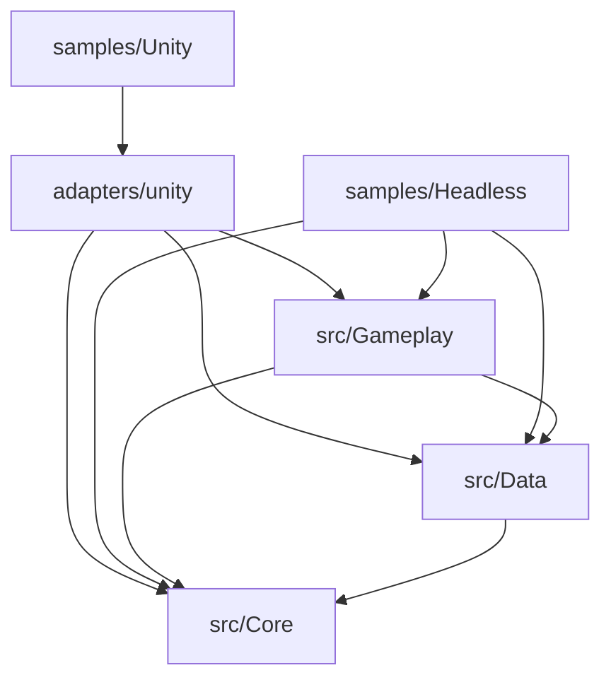

# 开发指引

## 开发顺序

1. 先读根 `AGENTS.md`，按任务找到对应模块 README；历史资料按需读取。
2. 通用逻辑放 `src`。只有实际调用引擎 API、需要引擎类型或引擎生命周期的内容放适配层。
3. 外部依赖通过显式配置、接口或宿主注册接入。通用 API 使用 BCL 类型和 `Task`，不返回 Unity 对象或 UniTask。
4. 先在 .NET 测试或无图形宿主验证行为，再验证相应引擎的适配。
5. 修改边界或公共接口时，同步更新模块 README、迁移指南和受影响的验证。

## 依赖方向

- Core 只依赖标准库，不包含任何引擎分支。
- Data 使用 Newtonsoft.Json；数据库驱动和额外二进制编解码器由宿主注册。
- Gameplay 接收普通 C# 数据。Unity 的 Resources、ScriptableObject 与 PlayerPrefs 位于适配包。
- 适配包可以引用通用模块；通用模块不能反向引用适配包、示例或其中的第三方 DLL。
- `Runtime` 是 .NET 与 UPM 共同使用的唯一源码位置；构建输出统一进入根 `artifacts`，避免 Unity 导入编译产物。

## 模块与扩展

| 任务 | 修改入口 | 验证方式 |
| --- | --- | --- |
| 生命周期、事件、服务注册 | `src/AwithGameFrame.Core/Runtime` | NUnit 测试 + 无图形示例 |
| 文件存取、序列化、数据库契约 | `src/AwithGameFrame.Data/Runtime` | 临时目录存取与重开测试 |
| 语言切换、存档槽位 | `src/AwithGameFrame.Gameplay/Runtime` | 普通数据集与存档恢复测试 |
| Unity UI/资源/音频/输入/场景 | `adapters/unity/Runtime` | .NET 边界检查 + Unity 编译/演示场景 |
| 接入新 C# 引擎 | 新建 `adapters/<engine>` | 引用通用项目，实现时间、日志、数据源与宿主入口 |
| 修改文档/目录 | 对应 README、`docs`、`AGENTS.md` | 检查链接及 `tools/verify.ps1` |

新模块有真实需求再创建独立项目；不为未接入的引擎建立空壳，不预设所有引擎都具备相同的 UI、音频或资源对象模型。

## 宿主接入

宿主设置 `LoggingHost.Output`、`LoggingHost.DataPath` 和 `TimeHelper.TimeSource`，驱动 `PerformanceMonitor.Tick(delta)`。引擎专用的加载逻辑通过适配器转换成普通数据；例如 `ILocalizationSource` 返回 `LocalizationDataset`。

存储路径由 `DataPersistenceConfig` 明确指定。Unity 使用 `UnityDataPersistence.CreateConfig()` 或 `UseUnityPaths(config)`，再调用 `UnityDataPersistence.InitializeAsync(...)`。普通 .NET 宿主直接初始化 `DataPersistenceAPI`。需要重新配置或结束会话时，停止业务继续发起存储请求，再 `await ShutdownAsync()`；它会等待经统一 API 发起的在途操作。直接调用提供者的操作由宿主自行等待。

当前保留旧命名空间与多数静态入口，便于迁移。新增业务优先使用可构造实例和显式依赖，不扩大全局单例。模块编排现有顺序保持不变，初始化高优先级在前，关闭逆序。

模块启动失败时会逆序回滚已经开始初始化的模块；`Shutdown()` 应能处理部分初始化状态。正常关闭会尝试清理所有已启动模块，再集中报告异常。注册模块应在启动前完成，生命周期转换期间不允许重入启动或新增注册。

## 当前范围与后续工作

本次完成源码、构建和引擎边界的拆分，以及 Unity 与无图形宿主的接入。网络、热更新、完整 ORM、云存储等仍需按实际项目需求独立推进；历史调研不代表这些能力已经实现。下一种引擎应通过一个可运行示例验证接口，再决定是否扩大抽象。

架构取舍见 [架构决策](docs/architecture.md)，旧 API 与目录变化见 [迁移说明](docs/migration.md)。
