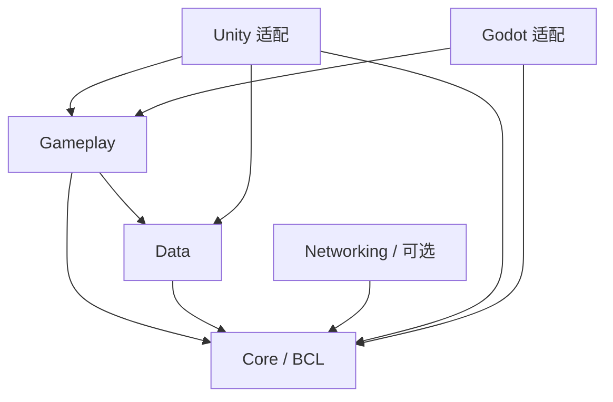

# 开发指引

先读 [协作约定](AGENTS.md)，再按任务进入目标区域和包 README。这里提供导航和共同边界；API 条件、资源所有权及线程要求由对应模块说明维护。

## 定位修改范围

| 内容 | 入口 | 主要验证 |
| --- | --- | --- |
| 宿主、事件、时间、对象池、资源 | [Core](src/AwithGameFrame.Core/README.md) | .NET 行为测试、Headless |
| 持久化、序列化、配置、数据库契约 | [Data](src/AwithGameFrame.Data/README.md) | 文件重开、配置/迁移测试 |
| 导航、视图/场景、输入/音频、设置与存档 | [Gameplay](src/AwithGameFrame.Gameplay/README.md) | 规则与服务测试、受影响的引擎验证 |
| HTTP、内容安装、长连接与恢复 | [Networking](src/AwithGameFrame.Networking/README.md) | 传输、取消、校验与会话测试 |
| 引擎对象、设备、加载和生命周期 | [adapters](adapters/README.md) | 对应真实编辑器和独立程序 |
| 共享应用、引擎接线和协议样例 | [samples](samples/README.md) | 样例及生成产物检查 |
| 开发工具、任务上下文与模板 | [tools](tools/README.md)、[agent](agent/README.md)、[templates](templates/README.md) | 工具契约、回归和模板编译 |
| 文档和目录导航 | [文档索引](docs/README.md)、[写作约定](docs/guides/documentation.md) | `tools/verify-docs.ps1` |

## 依赖边界

`src` 的依赖只向图中方向流动。Networking 不进入 Data/Gameplay；样例可以组合多个包。引擎适配可依赖通用包，通用包不引用适配、样例或其中的 DLL。完整包关系及可选 Unity 兼容/插件包见 [架构概览](docs/architecture/overview.md)。

每个通用包的 `.csproj` 与 UPM asmdef 共用 `Runtime` 源码，输出进入根 `artifacts`。引擎接口暴露原生类型时，接口也属于该引擎适配层。

## 实现与交付

可独立计算的领域规则使用显式输入和输出，应用服务负责采集事实、提交状态及执行效果。用户设置和视图布局已有这种分工，边界与成本见 [函数式核心指南](docs/guides/functional-core.md)。生命周期、资源租约和原生后端仍按各自所有权建模。

新增功能按 [开发步骤](docs/guides/add-feature.md) 操作；需要独立包时可复制 [portable-feature](templates/portable-feature/README.md)。公共 API、程序集或目录迁移同步更新 [迁移指南](docs/migrations/README.md)。

复杂或需要交接的工作使用具体目标、读写范围和验收条件；[AgentKit](agent/README.md) 可以按模块生成有限上下文，保存工具计划和执行证据。它的路径策略不提供操作系统沙箱，机器检查通过仍需真实评审。

交付前运行 `powershell -File tools/verify.ps1`（PowerShell 7 使用 `pwsh`），按影响执行真实引擎检查，并记录实际版本和未执行项。命令统一见 [验证参考](docs/reference/verification.md)，执行结果与历史证据见 [验证记录](docs/validation/latest.md)。
