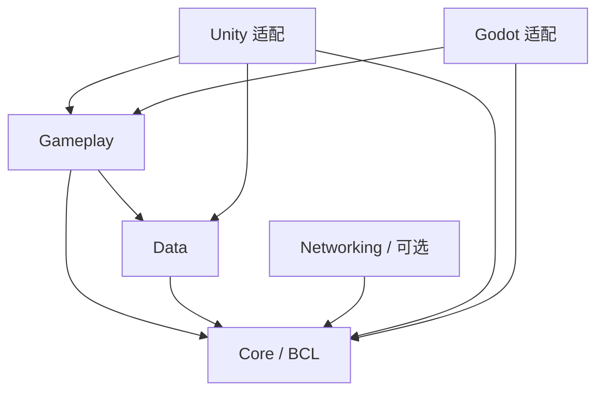

# 开发指引

按任务找到源码、模块说明和最接近变更的检查。跨模块约束见 [仓库协作约定](AGENTS.md)。

## 定位修改范围

| 内容 | 入口 | 主要验证 |
| --- | --- | --- |
| 具体游戏、外部代码与服务端 | [games](games/README.md)、[工作区入门](docs/getting-started/game-workspace.md) | 外部构建、服务端启动及选定真实引擎接入 |
| 宿主、事件、时间、对象池、资源 | [Core](src/AwithGameFrame.Core/README.md) | .NET 行为测试、Headless |
| 持久化、序列化、配置、数据库契约 | [Data](src/AwithGameFrame.Data/README.md) | 文件重开、配置/迁移测试 |
| 导航、视图/场景、输入/音频、设置与存档 | [Gameplay](src/AwithGameFrame.Gameplay/README.md) | 规则与服务测试、受影响的引擎验证 |
| HTTP、内容安装、长连接与恢复 | [Networking](src/AwithGameFrame.Networking/README.md) | 传输、取消、校验与会话测试 |
| 引擎对象、设备、加载和生命周期 | [adapters](adapters/README.md) | 对应真实编辑器和独立程序 |
| 共享应用、引擎接线和协议样例 | [samples](samples/README.md) | 样例及生成产物检查 |
| 开发工具、任务上下文与模板 | [tools](tools/README.md)、[agent](agent/README.md)、[templates](templates/README.md) | 工具契约、回归和模板编译 |
| 文档和目录导航 | [文档索引](docs/README.md)、[写作约定](docs/guides/documentation.md) | `tools/verify-docs.ps1` |

## 依赖边界

完整包关系与游戏工作区的数据流见 [架构概览](docs/architecture/overview.md)。

## 实现与交付

- 修改公共 API 或框架工具时，沿真实调用入口验证变更。新增通用功能可从已有模块或功能模板开始。 [框架开发技能](.agents/skills/awith-framework-development/SKILL.md) · [开发步骤](docs/guides/add-feature.md) · [功能模板](templates/portable-feature/README.md)
- 开发游戏玩法时，从所在游戏的 `game.json` 和 README 找到入口。可独立计算的规则使用显式输入和输出，应用层负责提交状态并执行效果。 [游戏开发技能](.agents/skills/awith-game-development/SKILL.md) · [函数式核心](docs/guides/functional-core.md)
- 排查或编辑 Unity 场景时，用编辑器命令检查实际组件和序列化字段。通用命令的验收使用独立夹具，具体游戏行为使用游戏工程验证。 [Unity 编辑器自动化](docs/reference/unity-editor-automation.md)
- 工作需要跨会话交接时，用 AgentKit 保存范围、检查和结果。 [AgentKit](agent/README.md)
