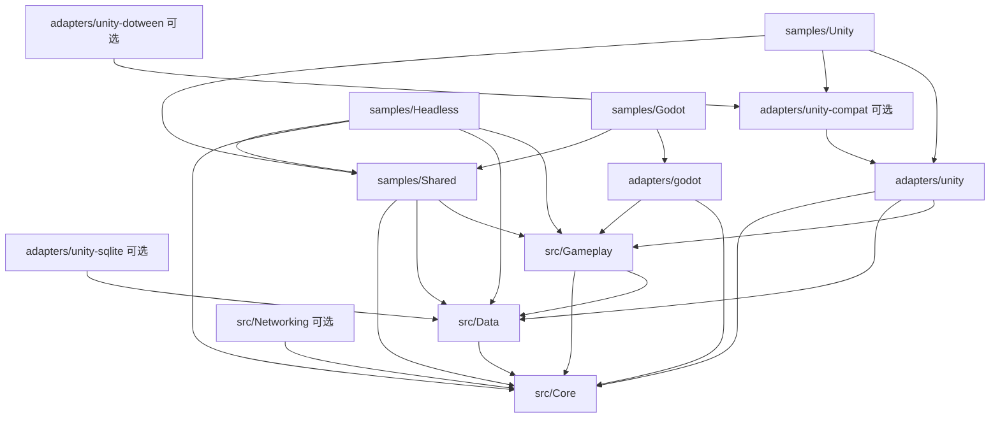

# 开发指引

## 开发顺序

1. 先读根 `AGENTS.md`，按任务找到对应模块 README；历史资料按需读取。
2. 通用逻辑放 `src`。只有实际调用引擎 API、需要引擎类型或引擎生命周期的内容放适配层。
3. 外部依赖通过显式配置、接口或宿主注册接入。通用 API 使用 BCL 类型和 `Task`，不返回 Unity 对象或 UniTask。
4. 先在 .NET 测试或无图形宿主验证行为，再验证相应引擎的适配。
5. 修改边界或公共接口时，同步更新模块 README、迁移指南和受影响的验证。

## 人类与 Agent 协作

需要可交接的开发任务时，从 [AgentKit](agent/README.md) 创建任务清单，填写具体目标、读写目录、保留的已有修改、工具和验收条件。先收集有限上下文，再实现；修改完成后重新收集上下文、生成工具计划、验证并交付报告。任务基线包含创建时的脏文件和暂存状态，不把已有修改自动算成本任务产物。已授权的常规操作继续执行，需要确认的具体计划登记真实的人类决定，不代签或重复索要已有授权。

`agent/tools.json` 是固定命令目录，`tools/AgentKit` 负责执行和留证，`artifacts/agent/tasks` 保存本地任务记录。任务范围能检查外部编辑是否越界，但不能代替操作系统权限隔离；模型 SDK、线上遥测和具体玩法尚由项目接入。新增可复用功能可复制 [portable-feature](templates/portable-feature/README.md)，保留 Domain 纯规则与 Application 显式效果的分工，并按说明重建新包 GUID。

## 依赖方向

- Core 只依赖标准库，不包含任何引擎分支。
- Data 使用 Newtonsoft.Json；数据库驱动和额外二进制编解码器由宿主注册。
- Gameplay 接收普通 C# 数据。Unity 的 Resources、ScriptableObject 与 PlayerPrefs 位于适配包。
- Networking 使用 BCL HTTP/WebSocket 和可替换 codec；HTTP 不隐式重试，Realtime 只按显式配置有限重连。内容更新与推送恢复不依赖 Gameplay/Data，不包含登录 UI、业务凭证管理或服务端代码。
- 适配包可以引用通用模块；通用模块不能反向引用适配包、示例或其中的第三方 DLL。
- `Runtime` 是 .NET 与 UPM 共同使用的唯一源码位置；构建输出统一进入根 `artifacts`，避免 Unity 导入编译产物。

## 模块与扩展

| 任务 | 修改入口 | 验证方式 |
| --- | --- | --- |
| 生命周期、服务注册、事件作用域 | `src/AwithGameFrame.Core/Runtime/Hosting`、`Events` | NUnit 测试 + 无图形示例 |
| 缩放/未缩放游戏时间、定时器 | `src/AwithGameFrame.Core/Runtime/Timing` | 时间缩放/暂停/取消/预算行为测试 |
| 普通对象池、资源作用域/缓存 | `src/AwithGameFrame.Core/Runtime/Pooling`、`Resources` | 借还所有权、共享/取消/缓存淘汰测试 |
| 文件存取、序列化、数据库契约 | `src/AwithGameFrame.Data/Runtime` | 临时目录存取与重开测试 |
| 实例本地化、统一用户设置 | `src/AwithGameFrame.Gameplay/Runtime/Localization`、`Settings` | 语言回退/绑定、设置迁移/保存/重建恢复测试 |
| 版本化存档、迁移、导航 | `src/AwithGameFrame.Gameplay/Runtime` | 迁移/故障恢复/取消与共享流程测试 |
| 视图/模态/焦点/绑定、场景所有权 | `src/AwithGameFrame.Gameplay/Runtime/Presentation`、`Scenes` | 服务行为测试 + 两端真实 prefab/PackedScene smoke |
| 输入动作/上下文、音频分组/并发/暂停策略 | `src/AwithGameFrame.Gameplay/Runtime/Input`、`Audio` | 普通后端行为测试 + 对应引擎 smoke |
| 网络、超时取消、会话边界 | `src/AwithGameFrame.Networking/Runtime` | 注入传输处理器的网络行为测试 |
| 原始文件内容更新、长连接恢复 | `src/AwithGameFrame.Networking/Runtime/Content`、`Realtime` | 校验/续传/原子激活、推送顺序/重连/会话隔离测试 |
| Godot 宿主/资源/视图/场景/输入/音频 | `adapters/godot`、`samples/Godot` | 真实 Godot .NET 编译/运行/导出 |
| 配置/协议生成 | `tools/ConfigGen` 与各样例 schema | 生成器行为测试、`-Check` 与兼容性基线 |
| AssetBundle/PCK 构建与装载 | `adapters/unity/Editor`、两端资源 loader、`tools/build-*-content.ps1` | 构建→发布→HTTP 安装→真实引擎依赖/释放断言 |
| Unity UI/资源/音频/输入/场景 | `adapters/unity/Runtime` | .NET 边界检查 + Unity 编译/演示场景 |
| 接入新 C# 引擎 | 新建 `adapters/<engine>` | 引用通用项目，实现时间、日志、数据源与宿主入口 |
| 修改文档/目录 | 对应 README、`docs`、`AGENTS.md` | 检查链接及 `tools/verify.ps1` |

新模块有真实需求再创建独立项目；不为未接入的引擎建立空壳，不预设所有引擎都具备相同的 UI、音频或资源对象模型。

## 规则与应用编排

用户设置已试点“函数式核心 + 命令式应用层”：`UserSettingsRules` 用显式数据完成合并、规范化、校验和内容比较，`UserSettingsService` 采集运行时事实、提交状态、调用设备和保存。修改设置规则时优先写无需宿主的输入/输出测试，涉及副作用和并发时保留服务回归。具体边界、调用示例与成本见 [试点说明](docs/functional-core-pilot.md)。

其他模块按需求逐步提取可独立计算的规则；不要求生命周期、资源租约或引擎后端改成不可变 reducer。纯函数可在内部使用循环和临时集合，关键是不修改调用方输入、不读取隐藏运行时状态、不产生外部副作用。序列化 DTO 可保持可变，跨规则边界须保证数据所有权。

视图布局也使用 `ViewLayoutRules`：输入视图请求和实例次序，输出排序、模态遮挡、输入与焦点状态；`ViewService` 只负责提交、原生调用和有序清理。视图/场景句柄不再公开原生对象或 scope 的释放权限，应用调用 Close/Unload，原生初始化留在后端回调。

## 宿主接入

Unity 新工程只安装 `adapters/unity`；旧服务另装 `adapters/unity-compat`（需要 UniTask），DOTween/SQLite 各装独立可选包及真实插件。新包没有旧静态帧驱动和本地化启动器。Core 旧全局表和单例集中在 `Runtime/Compatibility`，标准检查拒绝现代实例模块回流全局 API。包和程序集迁移细节见 [迁移说明](docs/migration.md)。

新项目优先使用可创建实例的 `GameHost`、`GameModule` 与 `GameContext`。模块通过稳定 ID 和 Dependencies 显式声明依赖，异步启动失败会回滚，停止会取消会话并逆序清理。每个会话创建新宿主；旧静态 Bootstrap/ServiceLocator 继续服务兼容代码，旧静态 API 不会随实例宿主自动隔离。

Unity 继承 `GameHostBehaviour`，Godot 继承 `GameHostNode` 并覆写 `ConfigureHost`。宿主在创建线程驱动 `Tick(unscaledSeconds)`，输入是未缩放的秒数；模块 `Tick` 收到 `Clock.ScaledDeltaTime`，`Clock.TimeScale` 默认 1。`Clock.UnscaledTime` 不乘 TimeScale，但宿主暂停、启动/恢复过渡和关闭时两个游戏时间域都冻结；`TimeScale = 0` 只冻结缩放域。不要在这些冻结阶段等待游戏定时器；现实时间等待由宿主另行提供。启动、暂停和异步关闭期间也要持续泵调度队列。普通 .NET 工具需提供单线程循环/同步上下文，参考 `DemoScenario.RunBlocking`。

`host.Events` / `Context.Events` 提供实例类型事件，订阅可使用 token、单个 IDisposable 或 `EventScope` 清理；Publish 在发布线程同步回调，错误通过结果报告，不自动切换到引擎线程。`Context.Timers` 提供缩放/未缩放域的单次、重复与 Delay，停止宿主会取消待执行工作。`Core.Pooling.ObjectPool<T>` 提供普通引用类型的容量、预热和租约，不自动管理 Unity GameObject/Godot Node，创建线程和销毁回调由模块负责。

窗口、场景或流程可以持有 `ResourceScope`：`ResourceStore` 合并同 key/type 加载。默认最后租约归还即释放；传入 `ResourceCacheOptions(maxBytes, maxEntries)` 后，无活跃租约且大小估算为正的资源可进入有限 idle LRU，活跃租约不会因预算被驱逐。`PreloadAsync<T>` 需要启用缓存，`TrimCacheAsync` 释放空闲项；预算是估算值，无法限制引擎全部内存。传入宿主 Dispatcher 确保原生加载/释放发生在引擎线程。Godot 可使用 `GodotThreadedResourceLoader`，不可原生取消的加载仍须等待晚到成功再释放。先清理业务作用域，最后停止资源模块和宿主；删除引擎对象前应显式等待 `ShutdownAsync`。

`GameHost.Lifecycle` 输出实例 ID、模块/操作、耗时、错误及回滚标记，可接自有结构化日志/指标后端；监听失败不改变生命周期行为。

以下为保留的静态入口接入约定：

宿主设置 `LoggingHost.Output`、`LoggingHost.DataPath` 和 `TimeHelper.TimeSource`，驱动 `PerformanceMonitor.Tick(delta)`。引擎专用的加载逻辑通过适配器转换成普通数据；例如 `ILocalizationSource` 返回 `LocalizationDataset`。

存储路径由 `DataPersistenceConfig` 明确指定。Unity 使用 `UnityDataPersistence.CreateConfig()` 或 `UseUnityPaths(config)`，再调用 `UnityDataPersistence.InitializeAsync(...)`。普通 .NET 宿主直接初始化 `DataPersistenceAPI`。需要重新配置或结束会话时，停止业务继续发起存储请求，再 `await ShutdownAsync()`；它会等待经统一 API 发起的在途操作。直接调用提供者的操作由宿主自行等待。

当前保留旧命名空间与多数静态入口，便于迁移。新增业务优先使用可构造实例和显式依赖，不扩大全局单例。旧静态模块编排仍按初始化优先级执行、逆序关闭；新 `GameHost` 则按 Dependencies 拓扑排序。

模块启动失败时会逆序回滚已经开始初始化的模块；`Shutdown()` 应能处理部分初始化状态。正常关闭会尝试清理所有已启动模块，再集中报告异常。注册模块应在启动前完成，生命周期转换期间不允许重入启动或新增注册。

## 通用服务与引擎后端

`ViewService` 管理视图 key、layer、模态输入屏障和焦点；`ViewFlow` 接到 `NavigationStack`，每个视图拥有独立资源 scope。`ViewBindingScope` 显式连接 `INotifyPropertyChanged`、getter 和 setter，初始同步后按属性名更新，Dispose/token 解绑；模型通知和控件 setter 必须在创建 scope 的宿主线程执行，后台数据先调度回宿主。`SceneService` 在新场景激活成功后提交 Single/Additive 状态，只卸载本服务拥有的场景，保留 bootstrap；取消或失败会清理晚到的原生实例。`PresentationModule`、`SceneModule` 默认依赖 `resources`，在资源模块之前关闭。

Unity 的 `UnityViewFactory` 需要专用 RectTransform parent 与宿主提供的 Canvas/EventSystem，`UnitySceneBackend` 使用 SceneManager additive 加载。Godot 的 `GodotViewFactory` 使用 Control PackedScene，`GodotSceneBackend` 管理持久 parent 下的子场景，不替换全局 CurrentScene。引擎 hooks 可绑定通用模型，原生实例创建/销毁和线程检查留在 adapter。`ViewBindingScope` 是显式单向绑定工具，复杂 MVVM 可由项目扩展。

`Gameplay.Input.InputService` 管理动作映射、优先级/模态上下文、重绑冲突及 Pressed/Held/Released，失焦/暂停释放已按下状态；`IInputBackend` 读取原生设备值。`Gameplay.Audio.AudioService` 管理 master/bus 音量、静音、循环/并发和播放 scope，区分用户暂停与宿主暂停；`IAudioBackend` 提供原生 voice。使用对应模块接入宿主生命周期，在创建线程操作，并在场景销毁前等待音频关闭。物理按键布局、平台设备与实际声音输出按目标环境验证。

将 `ViewInputRouter(views)` 传给 `InputService`，动作先到 UI，消费后不广播给玩法；持键被拦截会补发释放并抑制到物理释放，避免关闭弹窗后触发旧按键。输入路由内需异步修改视图时，通过 Dispatcher 排队，不能同步重入开关窗口。`AudioModule` 默认依赖 `resources`，暂停 Tick 使用维护回调回收允许继续播放的音效，游戏时钟仍冻结；外部自管资源时显式传空依赖。

新应用使用实例 `LocalizationService` 与 `UserSettingsService`。本地化支持父语言/默认回退、格式化与可解绑文本绑定；统一设置恢复语言、主/分组音量和重绑定，使用版本化存档完成迁移、备份及关闭保存。默认模块先启动资源/音频/输入/本地化，再应用设置，停止顺序相反。接入细节见 Gameplay 的 [本地化](src/AwithGameFrame.Gameplay/Runtime/Localization/README.md) 与 [设置](src/AwithGameFrame.Gameplay/Runtime/Settings/README.md)。

配置源支持枚举、数组、命名嵌套结构及各层外键检查，每张表可使用 UTF-8 JSON 或 CSV；生成普通 DTO 与 schema hash 表，工具用法及复杂样例见 [ConfigGen](tools/ConfigGen/README.md)。不要手改生成文件。

`Networking.Content.ContentUpdateService` 使用大小与 SHA-256 验证文件、复用已验证内容、续传并原子激活版本，`ContentSnapshot` 固定资源版本路径。`build-unity-content.ps1` / `build-godot-content.ps1` 生成 AssetBundle/PCK、目录和依赖，`publish-content.ps1` 发布文件清单；`verify-content.ps1` 以真实 HTTP 下载安装。两端资源 loader 从安装快照加载，完整步骤和 PCK 进程级挂载约束见 [资源流水线](docs/content-pipeline.md)。CDN、签名认证和历史版本磁盘回收策略由项目接入。

`Networking.Realtime.RealtimeClient` 组合 WebSocket transport、codec、心跳、有限重连与会话隔离，使用 `IPushRecovery` 请求最后已应用序号之后的完整推送快照，应用成功才推进游标。项目实现恢复 API、鉴权、服务端协议与持久化游标，并观察会话任务的错误；业务发送不会在断线后自动重放。当前是可测试的客户端能力与恢复契约，生产后端接入需单独验收。

## 当前范围与后续工作

当前提供共享宿主与流程、事件/时间/普通对象池、视图/绑定/场景、输入/音频、实例本地化与设置、配置/协议生成、版本化存档、资源作用域/idle 缓存、AssetBundle/PCK 构建发布及长连接客户端/显式恢复契约。Addressables、实际联网后端、平台 SDK、热更新、完整 ORM、云存储等按项目需求接入；历史调研不代表能力已实现。Unity/Godot/Headless 样例的实际编译、运行与导出范围见验证记录。

架构取舍见 [架构决策](docs/architecture.md)，旧 API 与目录变化见 [迁移说明](docs/migration.md)。
