# 当前项目框架架构与数据流

`samples` 是共享示例，`games/Test` 是具体游戏试点。Test 中的地图、Boss、武器、粒子预设、程序化环境、战斗音效和背景音乐都属于 Test 游戏层。

## 一、仓库整体结构

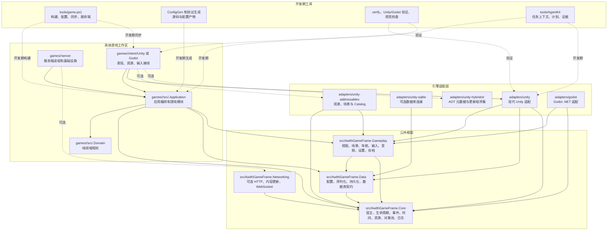

上图中的箭头表达依赖或调用方向。公共框架不依赖具体游戏，游戏 Application 组合游戏 Domain 和公共框架，客户端负责引擎对象与表现，服务端负责进程和服务器基础设施。

## 二、公共运行时的层级与依赖

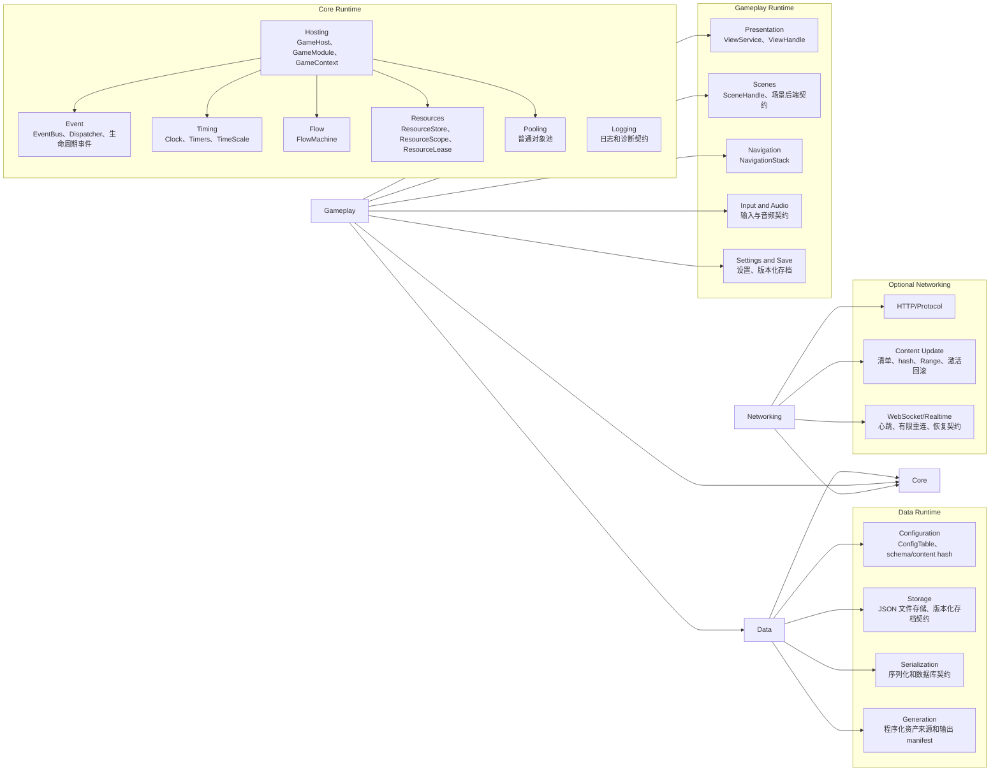

### 公共模块职责

| 模块 | 当前职责 | 依赖边界 |
| --- | --- | --- |
| Core | 独立的 `GameHost` 会话、模块生命周期、实例事件、时钟与定时器、流程、对象池、资源租约和日志 | 只依赖 BCL |
| Data | 配置表加载和校验、序列化契约、持久化存储和数据库契约 | 依赖 Core，不依赖引擎 |
| Gameplay | 视图、场景、导航、输入、音频、本地化、设置和版本化存档的共享服务与规则 | 依赖 Core 和 Data |
| Networking | HTTP、协议、内容更新、实时连接和恢复契约 | 只依赖 Core，属于可选包 |
| Unity 适配 | Unity 宿主驱动、Unity 资源、场景、视图、输入、音频和编辑器工具 | 可以依赖公共运行时，不被公共运行时反向依赖 |
| Godot 适配 | Godot .NET 宿主、PCK、场景、Control、输入和音频 | 可以依赖公共运行时，不被公共运行时反向依赖 |
| Unity 可选集成 | Addressables 资源与场景、HybridCLR 更新程序集、SQLite 连接 | 由各游戏选用 |

公共 `src` 包的源码只位于各包的 `Runtime/`。每个包同时维护 `.csproj`、`package.json` 和 `noEngineReferences=true` 的 Runtime asmdef。`src` 不引用 Unity、Godot、UniTask、适配器、样例或游戏 DLL。

## 三、GameHost 生命周期和帧数据流

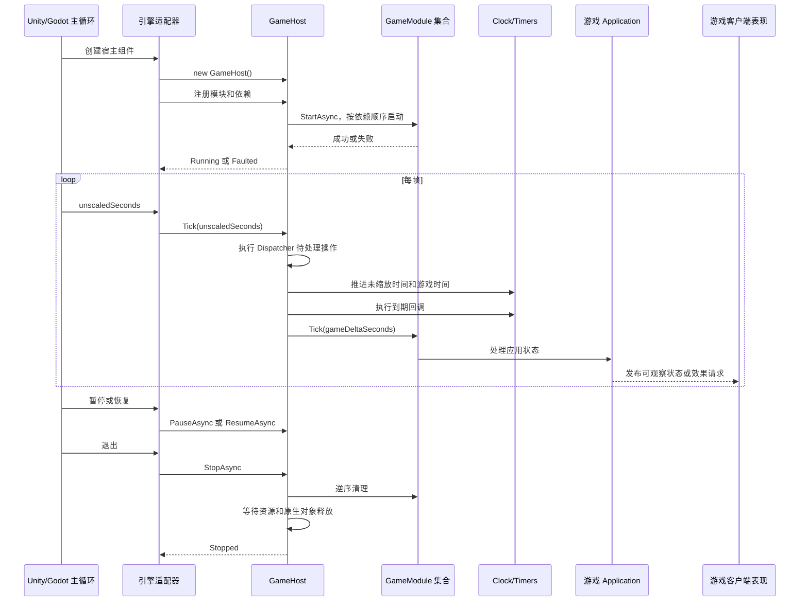

`GameHost` 每个实例拥有自己的服务表、事件总线、时钟、定时器、调度器和模块生命周期。宿主只能启动一次，停止或启动失败后应创建新宿主。暂停时游戏时间暂停，必要的维护调度仍可运行。

## 四、资源租约与释放数据流

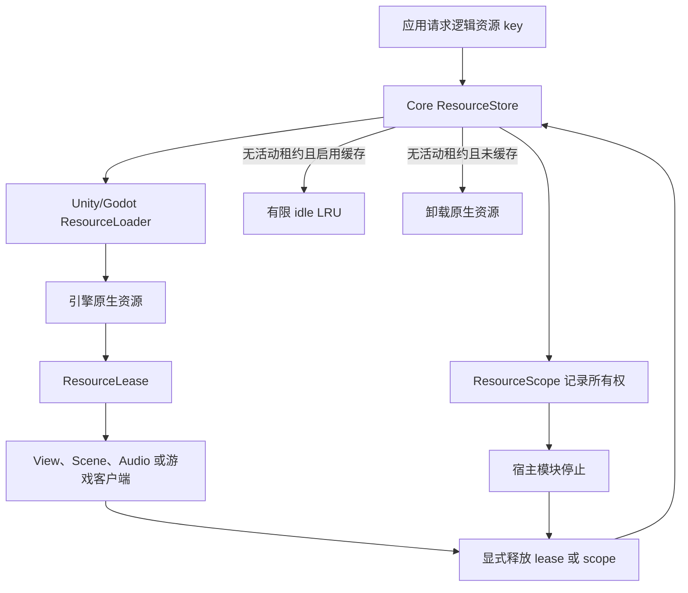

资源租约表达使用者的拥有关系。视图、场景和音频应先关闭原生实例，再归还资源，最后停止资源模块。缓存只约束空闲项，不替代调用方的租约释放。

## 五、配置、生成和运行时加载数据流

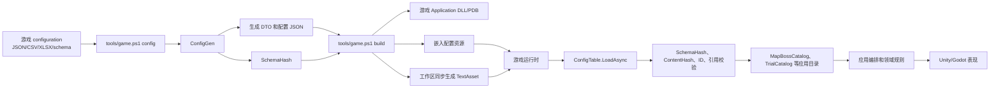

配置运行时不依赖 Excel、Unity 资源或代码生成器。生成器属于开发期工具，生成产物进入构建流程，运行时只接收普通 C# DTO 和配置字节。`SchemaHash` 表示结构指纹，`ContentHash` 表示本次加载的原始配置内容。

Test WebGL 由 Unity 客户端读取工作区导出的 TextAsset，再把配置正文交给 Application。普通 .NET 入口可读内嵌配置。`game.ps1 protocol` 可用 Buf 对照 Protobuf 基线，再用 protoc 生成 Application 使用的 C# 类型。 [游戏工作区](../getting-started/game-workspace.md)

## 六、游戏工作区构建和 Unity 同步

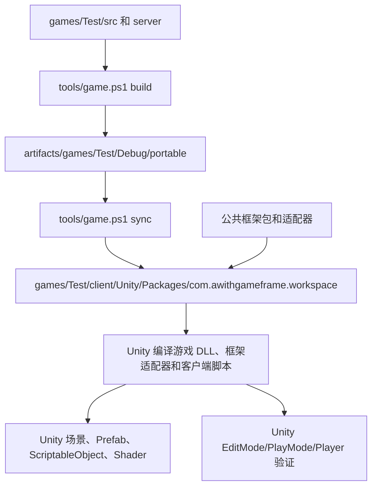

`sync` 会先构建当前外部 C# 代码，再更新 Unity 工作区包，避免客户端继续加载旧 DLL。`Packages/com.awithgameframe.workspace` 是工具拥有的生成目录，不手工混入插件，也不同时接入同名源码程序集和 DLL。

客户端选装 Addressables 或 HybridCLR 后，`sync` 将对应适配源码加入生成包。Addressables 把 Catalog 对应的资源和场景接入 `ResourceStore` 与 `SceneService`。HybridCLR 在 Windows IL2CPP Player 启动阶段校验 Player 身份和文件哈希，加载 AOT 元数据和更新程序集。工作区验证工具可构建 WebGL、启动无界面浏览器，并可调用微信小游戏 SDK 导出。 [真实验证记录](../validation/latest.md)

## 七、Test 游戏的实际分层

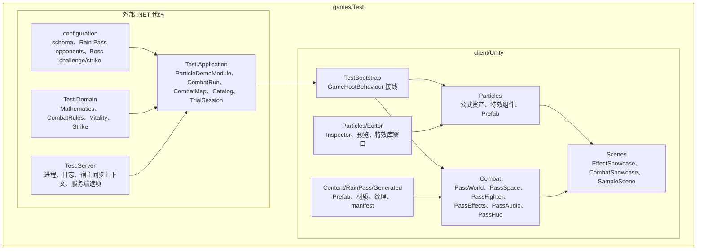

Test.Server 的 `OnlineProbePort` 入口在独立 ASP.NET Core 进程中接收 WebSocket 命令和心跳，断线后可通过 HTTP 查询状态。公共 Networking 包负责会话规则，测试命令和查询状态由 Test.Server 定义。 [Test 服务端](../../games/Test/server/Test.Server/README.md)

### Test 各区域职责

| 区域 | 当前内容 | 归属判断 |
| --- | --- | --- |
| `Test.Domain` | 发射公式、闪电路径、战斗伤害、格挡、弹反、破势、处决、弓箭规则 | Test 游戏规则，保持纯 C#，不是公共框架公式模块 |
| `Test.Application` | 粒子定时播放、战斗固定 60 Hz 推进、地图和 Boss 目录、试炼会话 | Test 应用编排，组合 Domain 与框架宿主 |
| `Test/client/Unity/Assets/Scripts/Particles` | Unity Inspector、公式资产、基础粒子系统、Prefab 预设、预览和特效库窗口 | Test 的 Unity 表现与编辑器工具 |
| `Test/client/Unity/Assets/Scripts/Combat` | 程序化地图、角色、武器、弓箭、雨、闪电、战斗特效、音效和 HUD | Test 的游戏表现层 |
| `Test/client/Unity/Assets/Content/RainPass/Generated` | 由环境参数烘焙出的可维护 Unity 资源 | Test 的生成资产产物，不是公共资源系统 |
| `Test/server/Test.Server` | .NET 服务端启动和基础设施接线 | Test 服务端，不进入共享领域规则 |

## 八、Test 粒子特效数据流

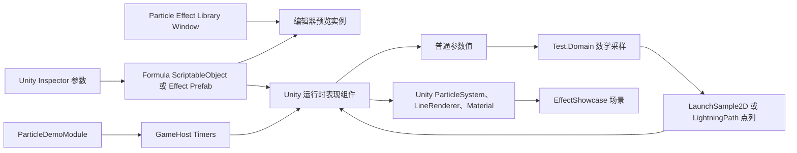

当前实现支持 `ProjectileFormula2D`、`SpiralFormula2D` 和 `LightningPath` 等 Test 领域算法。Unity 资产保存输入参数和表现配置，Domain 返回普通数据，Unity 组件负责把数据变成粒子、线段和材质表现。公式可扩展点目前属于 Test.Domain 的类型和测试，不是公共框架通用公式注册系统。

## 九、Test Rain Pass 战斗数据流

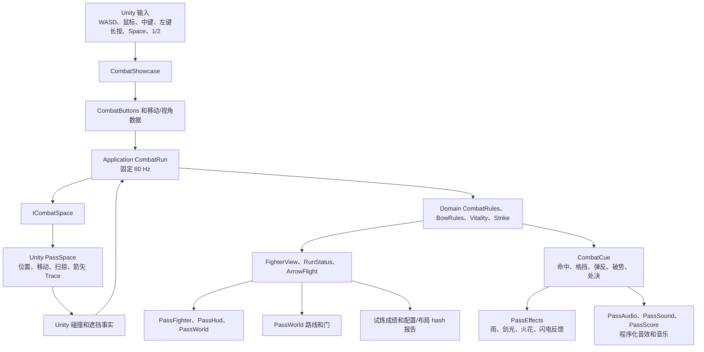

这里的边界是事实和规则分离。Unity 提供位置、遮挡、扫掠和箭矢碰撞等引擎事实，Domain 计算战斗结果，Application 管理会话和检查点，Unity 客户端消费状态并生成画面、声音和 HUD。

## 十、Test 配置 Boss 数据流

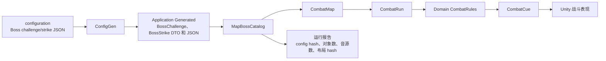

新增 Boss 配置的入口在 Test 的 `configuration` 和生成命令。Boss 目录、战斗行为和地图路线仍然是 Test 代码，公共框架只提供配置表加载、校验和构建接入能力。

## 十一、程序化环境资产流

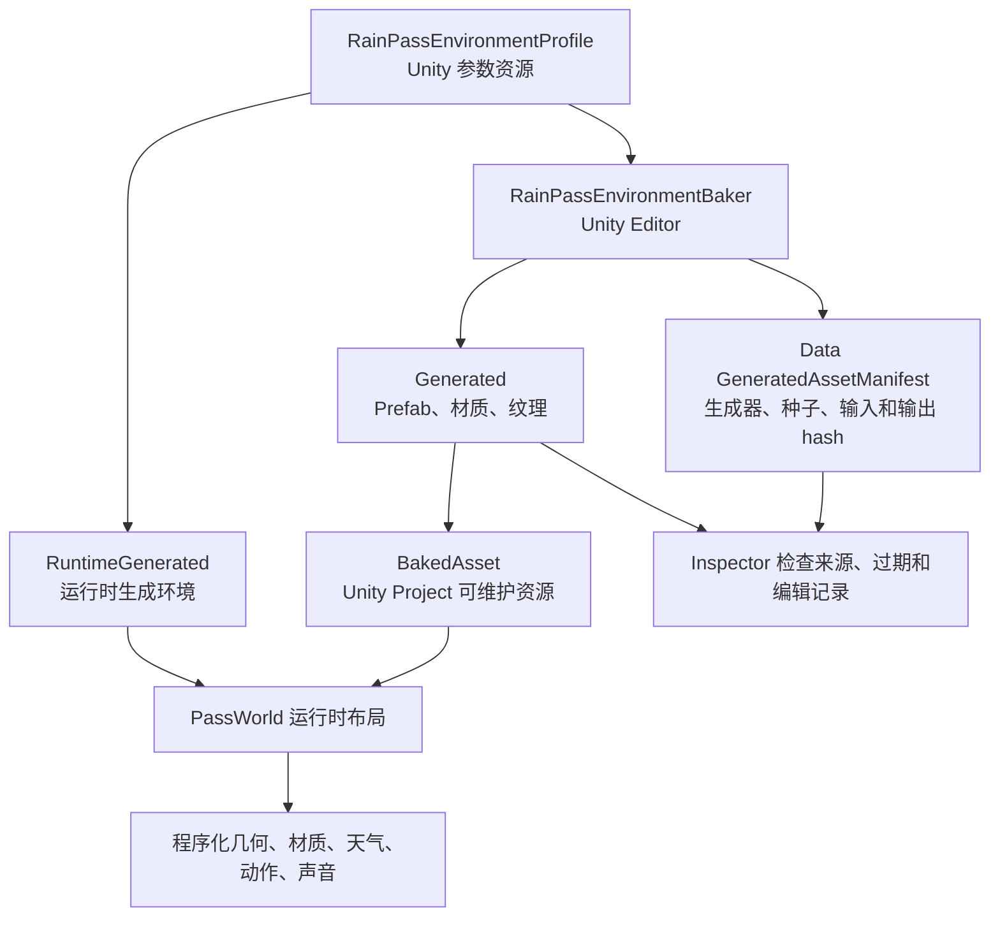

Test 客户端负责生成器、参数资源、可维护的 Unity 输出以及资产写入。Data 提供跨引擎的生成清单和指纹。 [程序化资产工作流](../reference/unity-procedural-assets.md)

## 十二、自动验证和人工验收边界

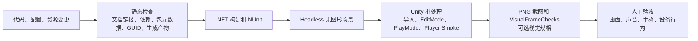

### 自动检查能确认的内容

- 依赖方向、模块清单、包元数据、UPM/asmdef 约束和本地文档链接。
- 公共框架的 .NET 构建、NUnit、Headless 和已登记的适配器断言。
- Unity 工程导入、编辑器测试、批处理 PlayMode、Windows Player 构建和后台 Player Smoke。
- 视觉规格提供截图时的尺寸、像素区域、对象数量或截图差异等机器可检查条件。
- Test 运行报告中的配置 hash、布局 hash、对象数量、音源数量和程序化建筑数量。

### 仍需要人工观察的内容

- 画面构图、层次、材质观感、UI 是否拥挤、粒子是否符合预期。
- 音乐和音效的听感、动态混音、重复感和不同设备播放效果。
- 战斗节奏、锁定、弓箭操作、处决长按和躲避手感。
- 目标设备上的输入、分辨率、前后台、性能和真实渲染差异。

默认验证采用无图形批处理。需要打开桌面编辑器的实时自动化或人工检查时，应在报告中单独记录启动入口、实际版本、检查项和 `manualReview` 状态。

## 十三、功能归属与入口

| 能力 | 归属 | 当前实际位置 |
| --- | --- | --- |
| 独立宿主、模块生命周期、实例事件和时间驱动 | Core | `src/AwithGameFrame.Core` |
| 资源租约、缓存和释放顺序契约 | Core 与引擎适配 | `src/AwithGameFrame.Core` 与引擎资源加载器 |
| 配置表 schema/content hash 和运行时引用校验 | Data 与生成工具 | `src/AwithGameFrame.Data`、ConfigGen |
| 程序化资产生成来源、输入/输出 hash 和过期判断契约 | Data | `AwithGameFrame.Data.Generation.GeneratedAssetManifest` |
| 视图、场景、导航、输入、音频、设置和存档的共享契约 | Gameplay 与引擎适配 | `src/AwithGameFrame.Gameplay` 与 adapters |
| HTTP、内容更新、WebSocket 恢复 | 可选 Networking 包 | `src/AwithGameFrame.Networking` |
| Unity/Godot 宿主和原生表现接线 | 引擎适配 | `adapters/unity`、`adapters/godot` |
| Unity 编辑器命令和后台验证 | Unity 适配与开发工具 | `adapters/unity/Editor`、`tools` |
| AgentKit 任务上下文、计划和证据 | 开发工具 | `tools/AgentKit`、`agent` |
| 粒子公式、公式资产、粒子预设和特效库 | Test Domain 与客户端 | `games/Test/src/Test.Domain`、`games/Test/client/Unity` |
| 雨、雪、火焰、星光、闪电链等具体特效 | Test 客户端 | `games/Test/client/Unity/Assets/Particles` |
| Rain Pass 地图、敌人、Boss、弓箭和战斗规则 | Test 外部 C# 与客户端 | `games/Test/src`、`games/Test/client/Unity` |
| 程序化环境烘焙器和生成材质 | Test 客户端 | `games/Test/client/Unity/Assets/Scripts/Combat/Editor`、`Assets/Content/RainPass/Generated` |
| 游戏专用音色、旋律和战斗混音 | Test 客户端 | `games/Test/client/Unity/Assets/Scripts/Combat` |

## 十四、从入口检查一条完整链路

以 Test 的 `CombatShowcase` 为例，调用链是：

```text
Unity 场景
  -> TestBootstrap / CombatShowcase
  -> Unity GameHostBehaviour
  -> GameHost 注册 Test.Application 模块
  -> CombatShowcase 采集输入并转换为 CombatButtons
  -> CombatRun.Step 推进固定频率战斗
  -> PassSpace 提供 Unity 事实
  -> Test.Domain 计算规则结果
  -> CombatCue / FighterView
  -> PassFighter、PassEffects、PassAudio、PassHud
  -> Unity 画面、声音和输入反馈
```

以 Test 的粒子场景为例，调用链是：

```text
Unity Inspector 或 Effect Library
  -> Formula Asset / Effect Prefab
  -> Unity 表现组件读取参数
  -> Test.Domain 生成采样点或速度
  -> Unity ParticleSystem、LineRenderer、Material
  -> EffectShowcase 显示
  -> ParticleDemoModule 通过 GameHost.Timer 触发重播
```
