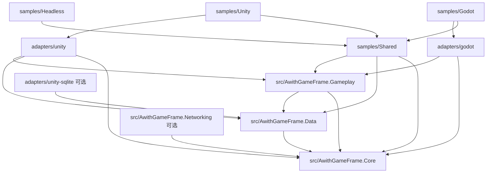

# 架构总览

通用运行时、引擎适配、可运行示例和开发工具分别维护。Unity 与 Godot .NET 是当前实现的宿主，共享逻辑使用普通 C# 数据和 BCL API。

按[产品方向](../product-direction.md)，具体游戏在 `games/<Name>` 维护外部 C# 代码、引擎工程与 .NET 服务端。默认一个游戏选择一个主引擎，多平台发布使用该引擎的构建能力。下图描述公共运行时与现有示例，游戏工作区在这些公共包之外组合依赖。

## 依赖与源码边界

| 层 | 职责与边界 |
| --- | --- |
| [Core](../../src/AwithGameFrame.Core/README.md) | 实例宿主、服务/模块、流程、事件、时间/定时器、普通对象池、资源所有权、日志；只依赖标准库 |
| [Data](../../src/AwithGameFrame.Data/README.md) | 持久化、数据库与序列化契约、强类型配置；依赖 Core 和 Newtonsoft.Json，具体数据库驱动由宿主注册 |
| [Gameplay](../../src/AwithGameFrame.Gameplay/README.md) | 视图/绑定/场景、导航、输入/音频、本地化、用户设置和版本化存档；依赖 Data/Core |
| [Networking](../../src/AwithGameFrame.Networking/README.md) | 可选 HTTP/协议、内容更新和 WebSocket 会话；只依赖 Core，不进入 Data/Gameplay 依赖 |
| [基础引擎适配](../../adapters/README.md) | Unity、Godot 的原生对象、资源和生命周期接入 |
| [可选集成](../../adapters/README.md#unity-项目可选集成) | 第三方 SDK 的公共接入，具体项目选择包和配套依赖 |
| [示例](../../samples/README.md) | 组合真实宿主和共享应用，验证模块怎样一起工作 |
| [游戏工作区](../../games/README.md) | 游戏专属规则、应用与启动接线，已有系统的衔接，独立 .NET 服务端、配置与协议源 |
| [开发工具](../../tools/README.md) | 生成、构建和验证；AgentKit 与模板用于开发，不进入游戏运行时 |

通用包以 .NET Standard 2.1、C# 9 为基线。每包的 `Runtime/` 是唯一源码，由 `.csproj` 和 UPM asmdef 共用；asmdef 设置 `noEngineReferences=true`。`src` 不引用引擎程序集、适配包、示例或其中的第三方 DLL。编译产物统一进入忽略提交的 `artifacts/`。其他语言需要独立桥接或实现，不能直接由 C# 边界推定已支持。

游戏的 `src/<Name>.Domain` 保持纯领域边界，`src/<Name>.Application` 组合领域与框架；客户端与 `server/<Name>.Server` 使用共享应用。游戏外部项目通过 `.csproj` 独立构建为 DLL，客户端由命令接入 DLL/PDB 与必要适配；公共框架不依赖具体游戏。目录、产物归属和取舍见[工作区决定](decisions/0002-game-workspace-and-binary-integration.md)，命令见[接入步骤](../getting-started/game-workspace.md)。

## 宿主与所有权

每个 `GameHost` 拥有自己的服务表、事件总线、时钟、定时器、调度器和模块生命周期。模块通过稳定 ID 与 Dependencies 声明依赖，启动失败逆序回滚，停止取消会话并逆序清理。每个会话创建新宿主；停止或启动失败的宿主不能重新启动。

宿主在创建线程输入 `Tick(unscaledSeconds)`。框架按 `TimeScale` 计算游戏 delta；暂停和生命周期过渡冻结两个游戏时间域，调度器与必要维护仍运行。实例事件在发布线程同步执行，更新原生对象前由调用方调度回宿主线程。`FlowMachine` 管理流程，`NavigationStack` 管理可恢复导航。

`ResourceStore` 以逻辑 key、请求类型、租约和 scope 管理共享加载。默认最后租约归还即释放；显式启用缓存后，无活跃租约的资产可进入有限 idle LRU。预算基于后端估算，只约束空闲项。视图、场景和音频先关闭原生实例，再归还资源，最后停止资源模块。删除宿主原生对象前显式等待 `ShutdownAsync`。

`ViewHandle` 和 `SceneHandle` 暴露应用所需的标识、状态与关闭/卸载操作。原生视图和服务借出的资源 scope 由后端创建回调使用，服务保持清理权限。设置与布局使用普通事实快照完成规则计算，服务负责提交状态及调用设备、事件和存储，详见[规则与应用编排](../guides/functional-core.md)。

## 引擎接入与兼容

Unity 包提供实例宿主、Resources/AssetBundle、视图、场景、输入、音频、日志和时间接入。项目按需选择 SQLite、Addressables 或 HybridCLR 集成。 [Unity 包](../../adapters/unity/README.md) · [可选集成](../../adapters/README.md#unity-项目可选集成)

[Godot 包](../../adapters/godot/README.md) 实现 .NET Node 宿主、资源/PCK、Control、场景、输入与音频，不复用 Unity 类型接口。每树退出协调器等待全部宿主清理后退出并恢复退出策略；启动期前后台状态在启动后回放。

## 数据与交付

配置和协议使用可审查 schema、确定性生成、普通 DTO、运行时结构校验和兼容性基线。生成工具独立于引擎。版本化存档将数据、元信息和 checksum 放入单个封装，原子提交并保留上一版；旧分离格式需要显式导入。

Networking.Content 提供文件清单、大小/hash 校验、续传和原子激活。Unity AssetBundle 与 Godot PCK 分别构建、发布并从固定快照加载，见[资源流水线](../guides/content-pipeline.md)。Godot 的 PCK 挂载属于进程，不能卸载或替换同 namespace。发布者认证、CDN 和历史版本磁盘回收由项目接入。

HTTP transport 默认单个响应正文最多 16 MiB，同时检查声明与实际读取长度。WebSocket 提供心跳、有限重连和显式推送恢复契约，不隐式重放业务操作。实际鉴权、服务端接口和业务幂等由项目实现。

根 [AGENTS.md](../../AGENTS.md) 保存协作规则，各包 README 保存局部接入事实；编辑器规则引用这些入口。架构背景见[引擎无关运行时决策](decisions/0001-engine-independent-runtime.md)，实际验证范围见[验证入口](../reference/verification.md)与[最近基线](../validation/latest.md)。
