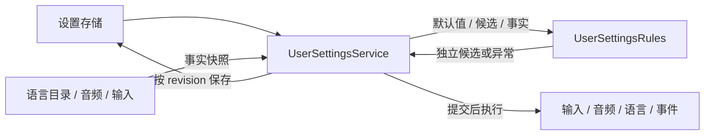

# 用户设置：函数式核心试点

最初试点覆盖 `Gameplay/Settings` 的规则计算，2026-10-27 继续提取视图布局。现有公共设置服务、序列化 DTO 和存档格式继续使用，Unity、Godot 与 Headless 共用同一份实现。

## 拆分后的边界

| 责任 | 实现位置 |
| --- | --- |
| 补齐构造默认配置、合并旧存档 | 纯 `CreateDefaults`、`Restore` |
| 完整校验、语言规范化、音量和绑定约束 | 纯 `Normalize` |
| 保留动态输入动作、批量交换和冲突判断 | 纯 `BuildInputBindings` |
| 判断内容和绑定是否变化 | 纯 `AreEquivalent`、`HaveSameBindings` |
| 采集运行时事实、宿主线程、取消和重入检查 | `UserSettingsService` |
| 提交候选、递增 revision、调用设备和发布事件 | `UserSettingsService` |
| 保存串行化、写入版本确认、失败重试与关闭 | `UserSettingsService` |

规则只接收普通数据，不接收宿主、服务、设备接口或查询委托。相同有效输入在相同文化数据库下得到相同结果；函数内部允许循环与临时可变集合。输出 DTO 的字典、列表和绑定均独立，输入在成功或抛错时都不修改。调用方不得在执行规则期间并发修改输入；结果是可编辑的独立数据，并非深度不可变类型。

## 具体变化

原 `Update` 在服务中复制候选、查询语言/总线/输入并校验，再提交状态和应用运行时。现在服务先采集事实，由 `Normalize` 返回完整候选；校验失败不会进入提交步骤。恢复时同样将缺项合并和规范化交给 `Restore`，只在异步加载完成后的宿主线程采集当前事实。

纯规则可单独用于设置预览、工具或测试，无需创建 `GameHost`、存储、音频或输入服务。API 示例见 [模块说明](../src/AwithGameFrame.Gameplay/Runtime/Settings/README.md)。构造默认值、恢复旧档和编辑候选各自保持不同策略：构造补默认项，恢复允许旧档缺项，编辑必须完整；旧存档中的未知 bus/action 继续要求显式 schema 迁移。

副作用继续按原契约执行：完整校验后先提交用户偏好，再更新输入、音频、语言和事件。后端或监听器失败时，已提交偏好仍 dirty，可 `Reapply`；仅改音量不重置持键。保存成功只确认实际写入的 revision，保存期间的新修改仍 dirty，停止失败可以重试。

## 效果与成本

服务文件从 391 行缩减至 276 行，新增规则文件 257 行，两者合计比原文件增加 142 行。规则计算从宿主编排中移出，新增测试直接传入值，能验证输入隔离、父语言支持、合并策略、绑定交换及动态动作冲突；原有服务测试继续覆盖线程、应用顺序、事件和保存竞态。这说明规则可以独立验证，不能据此推断运行性能提高。

总体源码增加了：独立 API、参数边界及运行时事实采集都需要代码，纯函数也继续深复制 DTO。此试点没有加入通用命令总线、effect 解释器或新的 Domain 项目。语言文化解析仍使用 BCL；本轮未引入全框架不可变集合或高频更新策略。

该方式适合继续提取有明确输入/输出的游戏规则。资源租约、宿主生命周期、设备后端等以状态和所有权为中心的代码，需要分别评估，不能据此批量改写。实际执行的测试与双引擎检查见 [验证记录](validation.md)。

## 第二个试点：视图布局

`ViewLayoutRules.Calculate(IReadOnlyList<ViewLayoutItem>)` 接收不可变的请求与实例编号事实，返回从低到高排列的只读布局结果。按 layer、实例编号排序，最高 modal 遮挡下层并限制焦点候选；最高可聚焦窗口获得焦点。规则不读取服务或原生控件、不修改输入，不接受重复实例编号。

`ViewService` 采集当前视图事实，调用规则后提交顺序和焦点，再逐个调用原生 `ApplyState`、汇总后端错误。Open/Close/Stop 的取消、重入保护、失败回滚和“隐藏视图 → 释放原生实例 → 归还资源”的顺序继续由服务负责。应用句柄只提供状态和关闭操作，不能绕过服务释放底层 scope。

纯规则测试覆盖排序、输入隔离、多个 modal、无焦点、关闭后恢复与非法输入；原服务、输入路由和真实双引擎 smoke 保留集成验证。规则分层增加事实/结果分配，未声称高频布局性能提升；布局重算发生在视图开关时，性能优化需另行测量。
