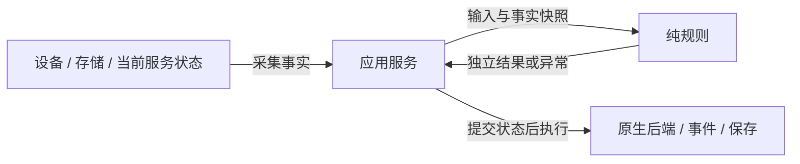

# 规则与应用编排

有明确输入/输出的领域规则使用纯函数，应用服务负责流程、状态提交和外部效果。当前设置与视图布局已经采用这个边界；新增功能可以复用同样的分工。

## 纯规则的边界

规则只接收普通数据，不接收宿主、服务、设备接口或查询委托，不读取隐藏运行时状态，不产生外部副作用。函数内部可以使用循环与临时可变集合。规则不修改调用方输入，返回结果须与输入保持独立所有权；序列化 DTO 可以可变，不要求全部类型深度不可变。

调用方应保证执行期间不并发修改输入。需要语言目录、已注册 bus/action 等事实时，服务先在正确线程采集快照，再调用规则。BCL 文化数据库等平台数据仍属于可重复性边界，测试应明确所依赖的语义。

## 用户设置

[UserSettingsRules](../../src/AwithGameFrame.Gameplay/Runtime/Settings/UserSettingsRules.cs) 提供以下计算，API 示例和完整默认策略见[设置模块](../../src/AwithGameFrame.Gameplay/Runtime/Settings/README.md)。

| 计算 | 责任 |
| --- | --- |
| `CreateDefaults`、`Restore` | 补齐构造默认项、合并旧存档 |
| `Normalize` | 完整校验、语言规范化、音量和绑定约束 |
| `BuildInputBindings` | 保留动态动作、覆盖/交换绑定并检查冲突 |
| `AreEquivalent`、`HaveSameBindings` | 比较内容，避免无意义的运行时应用 |

构造、恢复和编辑是不同策略：构造补默认项，恢复允许旧档缺项，编辑要求完整；旧存档中的未知 bus/action 需要显式 schema 迁移。支持父语言可接受对应区域语言，默认回退并不代表任意语言代码都有效。

`UserSettingsService` 在异步加载完成后回到宿主线程采集当前事实，完整校验后提交用户偏好与 revision，再应用输入、音频、语言和事件。后端或监听器失败时，已提交偏好仍 dirty，可 `Reapply`；仅改音量不重置持键。保存成功只确认实际写入的 revision，保存期间的新修改仍 dirty，停止保存失败可以重试。

纯规则可用于预览与工具，无需创建宿主或设备。预览结果经服务 `Update` 才提交，持久化仍显式执行 `SaveAsync`。

## 视图布局

`ViewLayoutRules.Calculate(IReadOnlyList<ViewLayoutItem>)` 接收只读的请求与实例编号事实，返回从低到高排列的只读布局结果。按 layer、实例编号排序，最高 modal 遮挡下层并限制焦点候选，最高可聚焦窗口获得焦点。规则不读取原生控件、不修改输入，不接受重复实例编号。

`ViewService` 采集当前事实，计算后提交顺序与焦点，再调用原生 `ApplyState` 并汇总错误。Open/Close/Stop 的取消、重入保护、失败回滚和“隐藏视图 → 释放原生实例 → 归还资源”继续由服务管理。应用句柄通过服务关闭，不能绕过服务释放借出的 scope。

## 实现与验证

新增功能可以从[portable-feature 模板](../../templates/portable-feature/README.md)开始：Domain 放纯规则，Application 放显式命令与效果；是否拆独立项目由实际分发和依赖需求决定。先写输入/输出、非法输入、输入/输出隔离和边界条件测试；应用服务继续验证线程、应用顺序、取消、并发与失败恢复，适配层保留真实引擎集成验证。

资源租约、生命周期和设备后端以状态与所有权为中心，按具体规则评估提取范围，不要求统一改成不可变 reducer。快照与独立结果会增加分配，规则提取本身不证明性能改善；高频路径应另行测量。历史试点测试和引擎结果保留在[2026-10 验证记录](../validation/history/2026-10.md)，当前验证命令见[验证参考](../reference/verification.md)。
